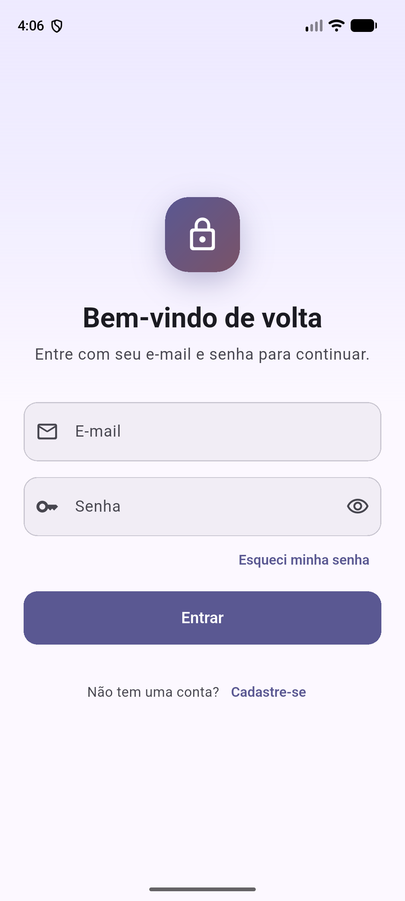
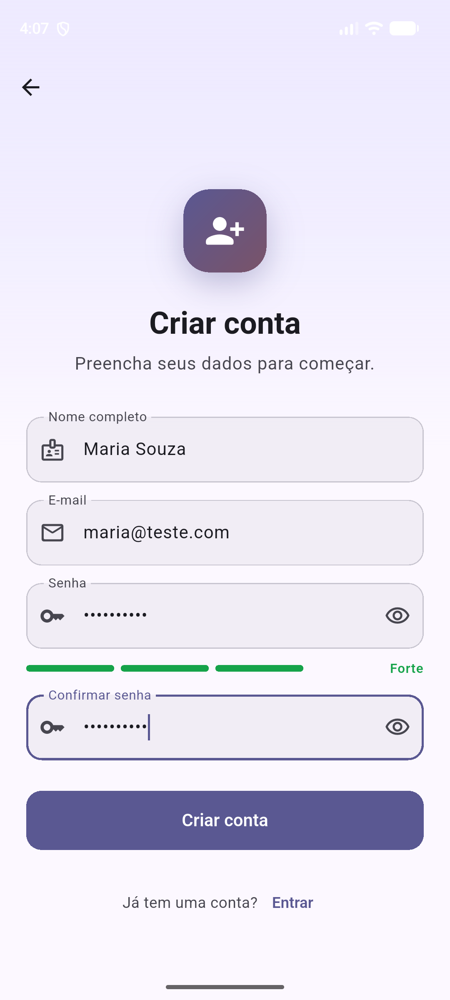
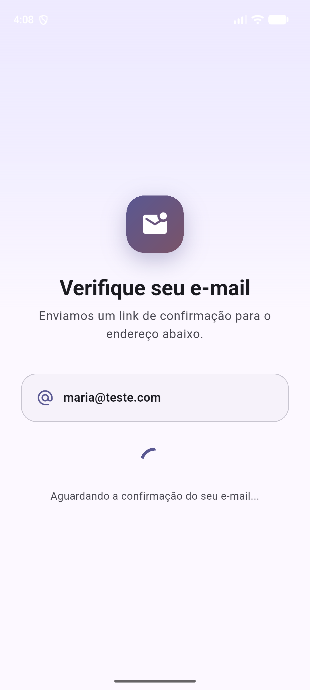
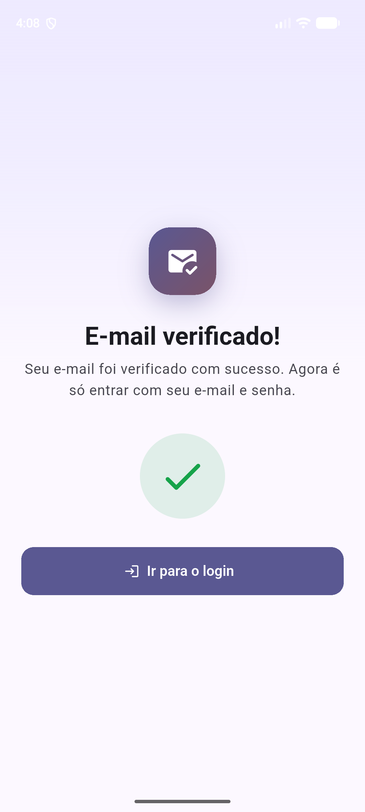
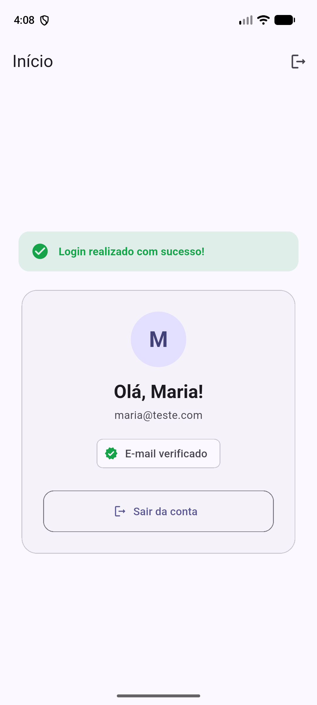
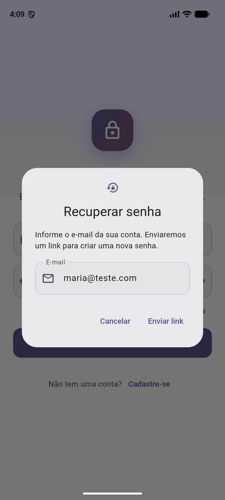
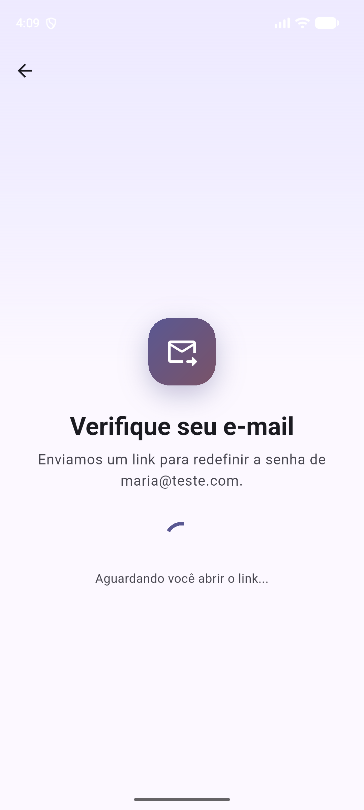
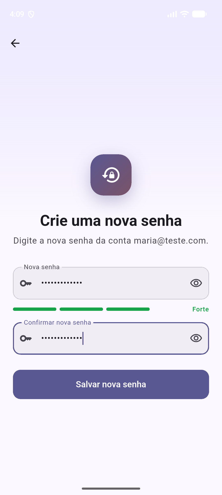
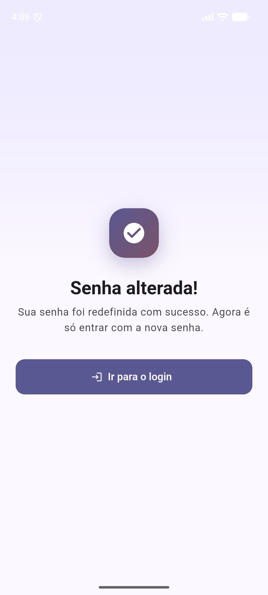

# App de Cadastro e Login (Flutter + Firebase)

Aplicativo Android em Flutter com cadastro e login de usuários por e-mail e senha, construído por etapas.

**Integrantes**
- Kaique Fantin Gaiarim — RA 60003260 ([@KaiqueFG](https://github.com/KaiqueFG))
- Gabriel Yoshio — RA 60006093

**Documentação complementar:** requisitos e histórias de usuário estão na [Wiki do repositório](https://github.com/KaiqueFG/trabalho-flutter-login/wiki).

## Como rodar

1. Instalar o Flutter SDK e o plugin Flutter no Android Studio
2. Abrir esta pasta no Android Studio e executar `flutter pub get`
3. Iniciar um emulador Android e clicar em **Run**

---

## Etapa 0 — Base do projeto, login e cadastro

### O que foi feito

- Criação do projeto Flutter, organizado por funcionalidade (`lib/features/auth` e `lib/features/home`)
- Tela de **login**, com mostrar/ocultar senha e opção "Esqueci minha senha"
- Tela de **cadastro**, com validação de nome, e-mail, senha e confirmação de senha, além de um indicador de força da senha
- Tela de **verificação de e-mail**: depois do cadastro, a verificação é simulada em 5 segundos e leva de volta ao login
- **Recuperação de senha**: envio do link (simulado), criação da nova senha e volta ao login
- Tela de **início** com a mensagem "Login realizado com sucesso!" e o botão de sair
- Autenticação baseada no modelo do **Firebase Auth** (e-mail e senha). Nesta etapa as contas ficam salvas no próprio aparelho (`shared_preferences`), com a senha protegida por hash SHA-256. A interface `AuthRepository` segue os métodos do Firebase Auth, para a troca pelo Firebase nas próximas etapas.
- Validações: e-mail único, senha com no mínimo 8 caracteres (letras e números), bloqueio de 30 segundos depois de 5 senhas erradas e nova senha diferente da atual
- Levantamento de requisitos e histórias de usuário na Wiki

### Prints

| Login | Cadastro | Verificando e-mail |
|:---:|:---:|:---:|
|  |  |  |
| **E-mail verificado** | **Início** | **Esqueci minha senha** |
|  |  |  |
| **Link enviado** | **Nova senha** | **Senha alterada** |
|  |  |  |

### Vídeo

_[link do vídeo não listado no YouTube]_

### Declaração de uso de IA

**Usamos IA?** Sim. Usamos o Claude (Anthropic), pelo aplicativo Claude Code, como assistente de programação. Nós definimos o que o app deveria fazer e guiamos a IA a cada passo. Ela gerou a maior parte do código e da documentação, e nós testamos, revisamos e pedimos as correções. Esta declaração também foi redigida com ajuda da IA e revisada por nós.

**Como trabalhamos com a IA:**
1. **Definimos** o que cada parte deveria fazer e pedimos à IA que implementasse
2. **Testamos** o resultado no emulador, como usuários comuns
3. **Encontramos os problemas** e pedimos as correções
4. **Revisamos** o código para entender cada parte antes de entregar

**Para que usamos:**
- Configurar o ambiente (Flutter, Git, Gradle e Java no Android Studio)
- Gerar o código das telas, das validações e da autenticação local
- Escrever testes automatizados
- Redigir os requisitos e as histórias de usuário a partir do que definimos

**O que a IA sugeriu:**
- Organizar o código por funcionalidade e separar a autenticação numa interface (`AuthRepository`) baseada nos métodos do Firebase Auth
- Integrar o Firebase de verdade desde o início
- Salvar a senha como hash SHA-256 com *salt*, em vez de texto puro
- Validar o nome só com letras e limitar o tamanho dos campos

**O que nós definimos e corrigimos:**
- **Escopo:** usar o Firebase Auth como modelo, sem conectar o Firebase real nesta etapa. Por isso a verificação de e-mail e a recuperação de senha são simuladas.
- **Fluxo do app:** cadastro → verificação de e-mail (5 segundos) → login → tela de "Login realizado com sucesso!"
- **Erros que encontramos testando o app:**
  - o "Esqueci minha senha" só mostrava uma mensagem, sem deixar criar a nova senha: pedimos a tela de redefinição
  - dava para redefinir a senha de um e-mail não cadastrado: pedimos o erro logo no envio do link
- **Revisão que pedimos à IA**, simulando um usuário comum. Ela apontou, e nós aprovamos corrigir:
  - o aviso de login aparecia toda vez que o app era reaberto
  - não havia limite de tentativas de senha (agora bloqueia por 30 segundos após 5 erros)
  - o nome aceitava números e a nova senha podia ser igual à antiga
- **Repositório e documentação:** escolhemos o que entra no repositório e deixamos a documentação mais objetiva

**O que aprendemos:**
- **Ambiente:** o Flutter precisa estar no PATH para o Android Studio reconhecer o projeto, e a versão do Gradle precisa ser compatível com a versão do Java. O Android Studio novo traz o Java 25, que só funciona com o Gradle 9.
- **Telas e navegação:** cada tela é um widget. Com o `Navigator`, uma tela é aberta por cima da outra (`push`), e dá para voltar até a primeira (`popUntil`). O `AuthGate` decide sozinho entre o login e o início conforme o usuário está logado ou não.
- **Formulários:** um `Form` com `validator` em cada campo verifica os dados antes de enviar, e cada regra devolve uma mensagem de erro.
- **Estado:** `setState` atualiza a tela quando algo muda, como o botão de carregando ou a troca da etapa de verificação para a de sucesso.
- **Segurança:** salvar a senha em texto puro é perigoso. Guardamos só o hash (SHA-256 com *salt*) e, no login, comparamos o hash da senha digitada com o salvo.
- **Requisitos:** requisitos funcionais descrevem o que o sistema faz; os não funcionais descrevem como ele deve ser (plataforma, segurança, usabilidade).
- **Revisão:** nem tudo que a IA gera está certo de primeira. Testando o app como usuários, encontramos pontos que faltavam, como a recuperação de senha que não verificava se a conta existia, e pedimos as correções.
